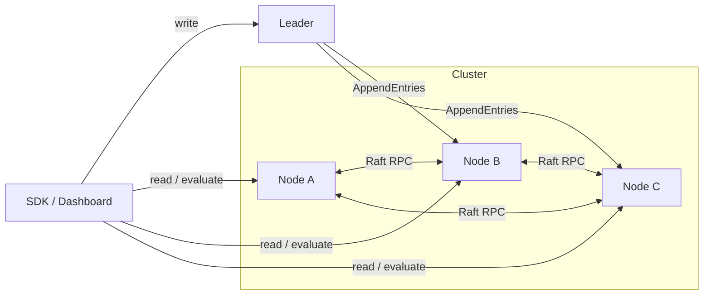

# FlagForge


**Self-hosted, strongly-consistent feature flags — powered by a from-scratch Raft implementation.**

FlagForge is an open-source alternative to hosted feature-flag SaaS (LaunchDarkly, Split, etc.). It runs as a single Go binary in a small cluster, replicates every flag change through the [Raft consensus algorithm](https://raft.github.io/raft.pdf), and keeps serving reads even while nodes crash, restart, or get partitioned away. It ships as one tiny container, so it deploys to **AWS ECS/Fargate for a few dollars a month**.

> Why it exists: a seed/Series-A startup wants gradual rollouts and kill-switches without paying per-seat SaaS pricing or risking an inconsistent config store. FlagForge gives you a consistent source of truth you fully own.

---

## What makes it interesting (engineering)

- **Raft written from scratch** — no `hashicorp/raft`, no embedded DB. Leader election, log replication with prev-log consistency checks, fast conflict backtracking, and the **Figure-8 commit-safety constraint** are all implemented directly from the paper (`internal/raft`).
- **Linearizable writes** — every flag change is proposed to the leader, replicated to a majority, and only then applied to the state machine, so all nodes converge on the same value.
- **Deterministic percentage rollouts** — a stable `fnv(user+flag)` hash buckets users, so a 30% rollout always targets the same ~30% of users across all nodes.
- **Zero-dependency WebSocket** — the live dashboard is fed by an RFC 6455 server implemented by hand (`internal/api/websocket.go`).
- **Race-tested** — the consensus core is covered by tests run under `-race`, including a chaos test that kills the leader and asserts a new one is elected.

## Architecture



Write path: `client → leader.Propose() → Raft log → majority AppendEntries → commit → FSM.Apply()`.

## Quick start

```bash
docker compose up --build
```

Open three dashboards:

- Node A → http://localhost:9001
- Node B → http://localhost:9002
- Node C → http://localhost:9003

Create a flag on the leader, watch it replicate instantly to the other two. Then **stop the leader container** and watch a new leader get elected live:

```bash
docker compose stop node-a   # if A is the leader
```

## API

| Method | Path | Description |
|--------|------|-------------|
| `GET`  | `/api/flags` | List all flags (replicated state) |
| `POST` | `/api/flags` | Create/update a flag (leader only) |
| `DELETE` | `/api/flags/{key}` | Delete a flag (leader only) |
| `GET`  | `/api/evaluate/{key}?user=id` | Evaluate a flag for a user (rollout-aware) |
| `GET`  | `/api/status` | This node's Raft status |
| `WS`   | `/ws` | Live status + flag stream |

Writes to a follower return `503` with an `X-Leader-Hint` header pointing at the current leader.

## Run locally without Docker

```bash
go build -o flagforge ./cmd/flagforge
PEERS="A=localhost:7001,B=localhost:7002,C=localhost:7003"
./flagforge --id A --http :9001 --raft :7001 --peers "$PEERS" &
./flagforge --id B --http :9002 --raft :7002 --peers "$PEERS" &
./flagforge --id C --http :9003 --raft :7003 --peers "$PEERS" &
```

## Tests

```bash
go test ./... -race
```

Covers leader election, log replication + commit on a majority, and leader-crash failover.

## Development

Common tasks are wrapped in a `Makefile` (`make help` lists everything):

```bash
make check            # lint (vet + gofmt) and run tests with the race detector
make race             # tests under the race detector
make run              # run a local node
make frontend-dev     # Vite dev server for the React/TS dashboard
make up               # docker compose up --build
```

## Deploying to AWS ECS/Fargate (low cost)

1. Build & push the image to ECR:
   ```bash
   aws ecr create-repository --repository-name flagforge
   docker build -t flagforge .
   docker tag flagforge:latest <acct>.dkr.ecr.<region>.amazonaws.com/flagforge:latest
   docker push <acct>.dkr.ecr.<region>.amazonaws.com/flagforge:latest
   ```
2. Create an ECS service with **3 tasks** (one per node) behind AWS Cloud Map (service discovery) so nodes can resolve `node-a/b/c`.
3. Put an ALB in front of the `:9001` port for the dashboard/API.
4. Fargate with 0.25 vCPU / 0.5 GB per task keeps this well under ~$15/month for a 3-node cluster.

> The binary is static (`CGO_ENABLED=0`) and the image is Alpine-based, so cold starts are fast and the attack surface is minimal.

## Project layout

```
cmd/flagforge        entrypoint & cluster wiring
internal/raft        from-scratch Raft (types, node, consensus, tests)
internal/store       flag state machine applied over the Raft log
internal/cluster     HTTP transport between Raft nodes
internal/api         public REST API + hand-rolled WebSocket
web/static           dependency-free live dashboard (Tailwind CDN)
```

## License

MIT
